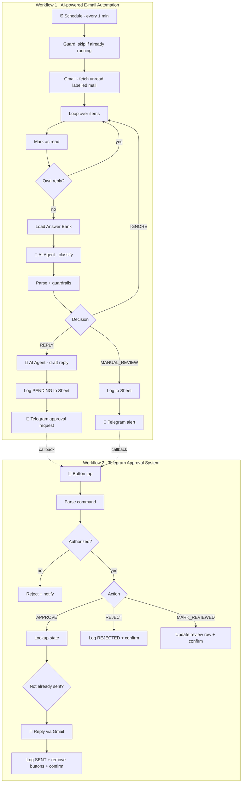

<div align="center">

# 📬 AI-Powered Email Classification & Approval Automation

**Local-LLM email triage · Human-in-the-loop approval via Telegram · Full audit trail in Google Sheets**

[](https://n8n.io)
[](https://ollama.com)
[](https://developers.google.com/gmail/api)
[](https://core.telegram.org/bots)
[](https://sheets.google.com)


*An inbox that triages itself, drafts replies, and never sends a word without your tap.*

</div>

---

## ✨ What It Does

Every minute, the system scans a labelled Gmail inbox, asks a **self-hosted LLM** to classify each email, drafts a reply when (and only when) it is safe to, and sends the draft to **Telegram** with **Approve / Reject** buttons. Nothing is emailed until a human approves it. Every state change is logged to **Google Sheets**.

| Capability | How it works |
|---|---|
| 🧠 **AI triage** | Classifies each email as `IGNORE`, `MANUAL_REVIEW`, or `REPLY` |
| 🛡️ **Deterministic guardrails** | Code-level rules override the LLM for sensitive and urgent emails |
| 📚 **Approved Answer Bank** | Auto-replies are only allowed when a verified, approved answer exists |
| ✍️ **Draft generation** | A second LLM agent writes a concise, professional reply |
| 📲 **Telegram approvals** | Inline buttons: ✅ Approve · ❌ Reject · ✅ Mark Reviewed · 📧 Open Gmail |
| 🔒 **Authorization check** | Only the configured Telegram chat can trigger sends |
| 🧾 **Audit trail** | Every request has a row in Google Sheets with status, approval, and sent state |
| 🔁 **Overlap protection** | Skips a run if a previous execution is still running |

---

## 🏗️ Architecture



---

## 🧰 Tech Stack

| Layer | Technology |
|---|---|
| Orchestration | [n8n](https://n8n.io) (self-hosted) |
| LLM runtime | [Ollama](https://ollama.com) running `gemma3:12b` |
| Mailbox | Gmail API (OAuth2) |
| Approvals | Telegram Bot API (inline keyboards) |
| State & logs | Google Sheets (OAuth2) |

---

## 🔐 Safety Model

Safety does not depend on the LLM behaving. The parser enforces these rules **in code**, after the model responds:

1. **Invalid or unparsable AI output → `MANUAL_REVIEW`** (fail closed).
2. **Sensitive keywords** (refund, payment, credit/debit card, password, credentials) → forced `MANUAL_REVIEW`.
3. **Urgent operational keywords** (machine down, line stop, ASAP, yield issue, tool fault…) → forced `MANUAL_REVIEW`, high priority.
4. **`REPLY` requires an approved Answer Bank match.** A `null`, empty, or placeholder answer is not approved.
5. **Idempotent sending:** approval is checked against the sheet so a reply cannot be sent twice.
6. **Authorized chat only:** unauthorized callbacks are rejected with a notice, and no email is sent.
7. **Reply drafts** never invent facts, never ask for passwords/OTPs/card numbers, and never mention AI or internal tooling.

---

## 📁 Repository Layout

```
.
├── workflows/
│   ├── AI-powered_E-mail_Automation-_akmartinez.json   # Ingest · classify · draft · request approval
│   └── Telegram_Approval_System-_akmartinez.json       # Handle button taps · send/reject/log
└── README.md
```

---

## 🚀 Setup Guide

### 1 · Prerequisites

- n8n (self-hosted, with the public API enabled)
- Ollama with the model pulled: `ollama pull gemma3:12b`
- A Gmail account with a label for emails to process
- A Telegram bot (create one with [@BotFather](https://t.me/BotFather))
- A Google Sheet (see schema below)

### 2 · Import the workflows

In n8n: **Workflows → Import from File**, then import both JSON files.

### 3 · Create credentials

The exported files contain **placeholders only**. No real secrets are included. Create these in n8n and attach them to the matching nodes:

| Credential | Used by | Where to get it |
|---|---|---|
| Gmail OAuth2 | Fetch, mark read, send reply | Google Cloud Console → OAuth client |
| Google Sheets OAuth2 | All logging and lookup nodes | Google Cloud Console → OAuth client |
| Telegram API | Alerts, approvals, trigger | Bot token from @BotFather |
| Ollama API | Both AI agents | Your Ollama base URL |
| n8n API key | "Check Running Executions" node | n8n → Settings → API |

### 4 · Replace the project-specific values

Search each workflow for these and swap in your own:

| Value | Node(s) | Notes |
|---|---|---|
| `put n8n api key` | Check Running Executions | Header `X-N8N-API-KEY` |
| Gmail label ID | Get many messages | The label of emails to process |
| Telegram chat ID | Alert, approval request, auth check | Your numeric chat ID |
| Mailbox address | Own Reply? | Prevents the bot answering its own replies |
| Google Sheet ID | All Sheets nodes | Your "Email State Log" sheet |
| Error workflow ID | Workflow settings | Optional; point to your own |

### 5 · Create the Google Sheet

One tab (`Sheet1`) with these headers:

```
timestamp | request_id | status | approval_status | sent_status | message_id | thread_id | sender | subject | to | reply_subject | reply_body | output
```

### 6 · Fill the Answer Bank

Edit the **Load Answer Bank** code node. Entries with `answer: null` always route to a human. The bundled answers are **provisional test content**; replace them with approved ones before production.

### 7 · Activate

Activate both workflows. Send a test email to the labelled inbox and watch Telegram.

---

## 🔄 Request Lifecycle

| Stage | `status` | `approval_status` | `sent_status` |
|---|---|---|---|
| Draft created | `PENDING` | `PENDING` | `NO` |
| Approved and sent | `SENT` | `APPROVED` | `YES` |
| Rejected | `REJECTED` | `REJECTED` | `NO` |
| Manual review flagged | `MANUAL_REVIEW` | `PENDING_REVIEW` | `NO` |
| Manual review done | `REVIEWED` | `REVIEWED` | `NO` |

---

## 🧪 Customizing

- **Swap the model:** change `gemma3:12b` in both Ollama nodes (or replace them with any n8n chat-model node).
- **Tune guardrails:** edit `sensitivePatterns` and `urgentPatterns` in **Parse Classification**.
- **Polling speed:** change the Schedule Trigger interval and the Gmail `limit`.
- **Greeting and signature:** edit the reply-agent prompt and the HTML formatter node.

---

## 🤝 Contributing

Issues and pull requests are welcome. Please never commit real tokens, chat IDs, or sheet IDs.

## 📄 License

MIT. See `LICENSE`.

<div align="center">

**Built by [Anukul Chandra](https://github.com/Anukul-Chandra)** · If this helped you, drop a ⭐

</div>
